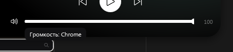
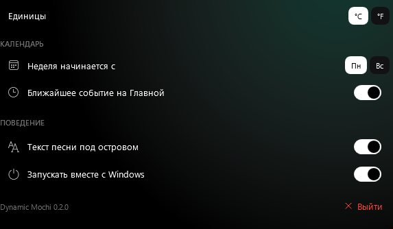
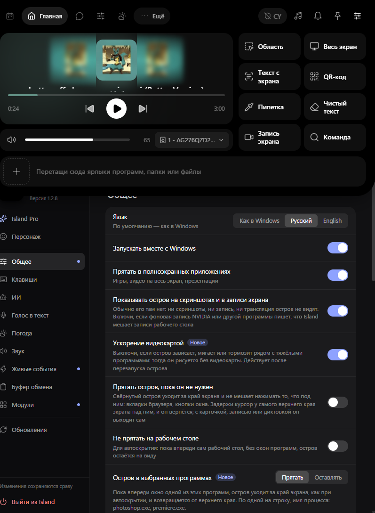
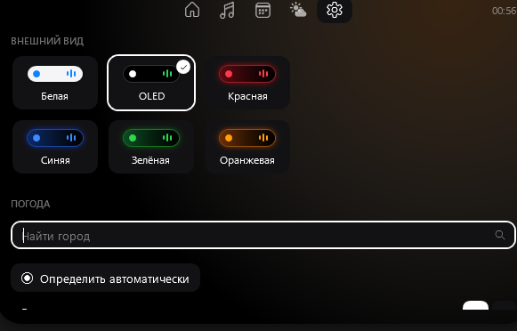
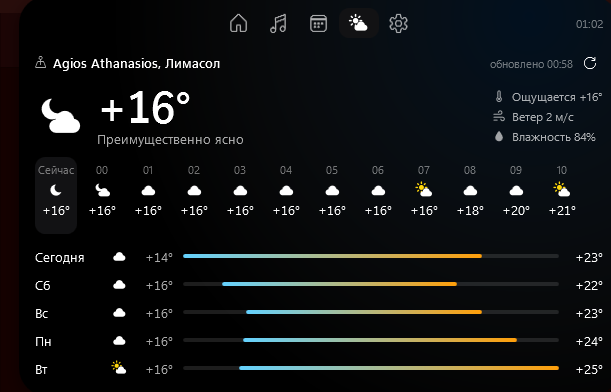

# Dynamic Mochi: задание v1.3

Этен → Бену. Коротко и по пунктам. Общие правила дизайна из `docs/DESIGN.md` и токены тем из `SPEC-v1.2.md` (раздел T) остаются в силе. Не трогать то, что уже работает (темы, календарь, погода, громкость) — только перечисленное ниже. Коммиты как раньше (автор enlxxx, без Co-Authored-By).

Порядок: 1 → 2 → 3 → 4 → 4.5 → 5 → 6.

**Скрины от тестера** (лежат в `docs/screens/v1.3/`, открой их перед началом):
- `01-volume-tooltip-and-thumb.png` — тултип «Громкость: Chrome» и обрезанный бегунок (пункт 1)
- `02-settings-city-search.png` — поиск города прямо в настройках, тесно и неудобно (пункт 3.4)
- `03-settings-bottom.png` — текущий низ вкладки настроек (пункт 3.1)
- `04-weather-tab-current.png` — вкладка Погода сейчас: сама по себе хорошая, на неё ложится живой фон (пункт 4.5); название места пришло не по-русски (3.4)
- `05-reference-other-app.png` — чужое приложение, **только как пример идеи**: отдельное окно настроек с боковым меню и подробными описаниями строк. Не копировать вид — делать в нашем стиле.

---

## 1. Мелкие баги громкости (вкладка Музыка)

- **Убрать тултип** «Громкость: Chrome» при наведении на иконку громкости. Никаких тултипов на ней.
- **Бегунок слайдера обрезается** на краях (на 100% кружок наполовину уходит за правый край). Дорожка должна иметь внутренний отступ по бокам = радиус бегунка (6 px), чтобы кружок целиком помещался и на 0, и на 100. То же проверить для прогресс-бара трека.

---

## 2. Шрифты

Системные шрифты выглядят дёшево. Встроить в приложение свои (файлы в `Assets/Fonts`, `Resource` в csproj, лицензии OFL положить рядом в `Assets/Fonts/LICENSES`):

- **Интерфейс:** **Inter** (Regular 400, Medium 500, SemiBold 600). Отличная кириллица, ровный и современный.
- **Часы и крупные цифры:** **Inter Display SemiBold** с моноширинными цифрами (`Typography.NumeralAlignment="Tabular"`), лёгкое сжатие трекинга −1% на размерах ≥ 22 px.
- Шрифт задаётся **в одном месте** (ресурс `UiFont` / `DisplayFont`) — нигде в XAML не писать `FontFamily` вручную.
- В полных настройках (раздел 3) — выбор шрифта: **Inter** (по умолчанию), **Manrope**, **Onest**, **Segoe UI Variable** (системный). Смена применяется сразу ко всему острову. Все три встроенных — с кириллицей, OFL.
- Часы в покое (свёрнутая idle-капсула) — `DisplayFont` 22 px SemiBold, как в 1.2, но уже новым шрифтом.

---

## 3. Полноценное окно настроек (отдельное приложение-окно)

Сейчас все настройки впихнуты во вкладку острова — тесно. Делаем как у нормальных программ: **отдельное окно «Dynamic Mochi — настройки»**, в нашем стиле (не копировать чужие приложения).

### 3.1 Как открывается
- Во вкладке «Настройки» острова остаются только **быстрые** вещи: выбор темы (карточки), тумблер «Текст песни», и внизу большая кнопка-плашка **«Все настройки»** (иконка `E713`, во всю ширину, высота 40, `Surface`, скругление 10). Плюс «Выйти».
- Правый клик по капсуле → маленькое меню в стиле темы: «Все настройки», «Выйти».
- Иконка в трее (system tray): клик — открыть настройки, правый клик — меню «Все настройки / Выйти».
- Повторное открытие не создаёт второе окно — активирует существующее.

### 3.2 Окно
- Обычное окно Windows 11: 900×640 (мин. 760×520), фон **Mica** (`DWMWA_SYSTEMBACKDROP_TYPE`), тёмная/светлая шапка по теме острова, скруглённые углы системы. Запоминает размер и позицию.
- Слева **боковое меню** 220 px: иконка + название раздела, активный пункт — плашка `Surface` со скруглением 8 и цветной полоской 3 px `Accent` слева. Внизу меню — версия «Dynamic Mochi 0.3.0» 11 px `Faint` и кнопка «Выйти из Dynamic Mochi» красным.
- Справа контент раздела: заголовок раздела 22 px SemiBold, под ним карточки-группы (фон `Surface`, скругление 12, строки 52 px, разделители 1 px `Faint` 15%). У каждой строки: название 14 px + описание 12 px `Sub` под ним (одна-две строки, что делает настройка), контрол справа.
- Сверху контента — **поиск по настройкам** (поле 36 px): фильтрует строки по названию и описанию во всех разделах.
- Изменения применяются **сразу**, без кнопки «Сохранить». Внизу меню подпись «Изменения сохраняются сразу» 11 px `Faint`.

### 3.3 Разделы
1. **Общее**
   - **Размер острова:** сегменты «Компактный / Обычный / Крупный» (масштаб 0.9 / 1.0 / 1.15 от текущих размеров) + слайдер точной настройки 80–130%. Остров меняется вживую, пока двигаешь.
   - **Отступ сверху:** слайдер 0–24 px.
   - **Монитор:** выпадающий список (Основной / Монитор 2 …), если мониторов больше одного.
   - **Вид в покое:** «Минимальный» (по умолчанию, см. раздел 4) / «Подробный» (как сейчас).
   - **Прятать в полноэкранных приложениях** (игры, видео, презентации) — тумблер, по умолчанию вкл.
   - **Запускать вместе с Windows** — тумблер.
   - **Язык:** «Как в Windows / Русский / English» — пока только заготовка (строки вынести в ресурсы), English можно доделать позже.
2. **Внешний вид**
   - Темы — те же 6 карточек, но крупнее (сетка 3×2, карточка 180×96 с мини-капсулой).
   - **Шрифт** (раздел 2).
   - **Цветное пятно от обложки** — тумблер.
   - **Анимации:** «Обычные / Быстрые / Без анимаций» (множитель длительности 1 / 0.6 / 0).
3. **Музыка**
   - Текст песни под островом — тумблер; размер текста — слайдер 13–18 px.
   - Показывать эквалайзер — тумблер.
   - Громкость: «Только плеера / Системная».
4. **Погода**
   - **Место** — тут живёт выбор города и района (см. 3.4).
   - Единицы: °C / °F; ветер: м/с / км/ч.
   - Показывать погоду в свёрнутом острове — тумблер.
5. **Календарь**
   - Неделя начинается с Пн / Вс; ближайшее событие на Главной — тумблер; напоминания в острове — тумблер; длительность показа напоминания 5 / 8 / 15 с.
6. **О программе**
   - Версия, ссылка на GitHub, кнопка «Открыть папку с логами», «Сбросить все настройки» (красная, с подтверждением).

### 3.4 Выбор места (внутри раздела «Погода»)
- Сверху список сохранённых мест (до 3): карточки-строки, активное с галочкой, крестик удалить при наведении.
- Кнопка **«Добавить место»** открывает аккуратный диалог поверх окна настроек (затемнение фона, карточка 440 px по центру): поле «Город, район или улица» с автофокусом, результаты по мере ввода (города — Open-Meteo, районы — Nominatim, как в v1.2), шаг «Уточнить район (необязательно)» с кнопками «Готово / Пропустить», строка «Определить автоматически».
- Названия мест показывать по-русски (`language=ru` / `accept-language=ru`); если русского нет — как пришло.
- **Из острова:** клик по названию места во вкладке Погода (или «Выбрать» в пустом состоянии) открывает окно настроек сразу на разделе Погода с открытым диалогом добавления. В самом острове полей ввода больше нет.

---

## 4. Минимальный вид в покое (по умолчанию)

Пока на остров не навели мышь, он должен быть **чистым и спокойным**, как настоящий Dynamic Island. Всё подробное — только при наведении.

- **Ничего не играет:** капсула 200×36 (с учётом масштаба из Общего): только часы по центру, `DisplayFont` 17 px SemiBold. Дата и погода — только в «Подробном» виде.
- **Играет музыка:** капсула 240×36: слева обложка 24×24 (скругление 7), справа эквалайзер. Название трека не показывать. По центру пусто — или часы 13 px, если включено «Часы при музыке» (тумблер в Общем, по умолчанию вкл).
- **Наведение:** через 150 мс капсула сначала мягко подрастает до размеров «Подробного» вида (340×52 с названием), и если мышь держится дальше — раскрывается полностью, как сейчас. Это даёт «живое» ощущение вместо резкого прыжка.
- Live-события (напоминание календаря) в минимальном виде показываются так же, как в v1.2, потом капсула возвращается в минимальную.

---

## 4.5 Живой фон погоды (вкладка «Погода»)

Пока открыта вкладка Погода, за контентом идёт **анимация текущей погоды**. Она заменяет статичное цветное пятно по погоде из v1.2 (пятно оставить как подложку под анимацией).

| Погода (WMO-коды) | Анимация |
|---|---|
| Ясно днём (0–1) | мягкий тёплый ореол солнца в правом верхнем углу, медленно «дышит» (масштаб 1 ↔ 1.06, 6 с), 3–4 едва заметных луча медленно вращаются |
| Ясно ночью | 25–40 звёзд-точек 1–2 px, мерцают в случайном порядке; раз в ~20 с — падающая звезда |
| Облачно / переменно (2–3) | 3–4 размытых облака-пятна дрейфуют слева направо с разной скоростью (параллакс) |
| Туман (45, 48) | 2–3 горизонтальные полосы дымки медленно плывут в разные стороны |
| Морось (51–57) | редкие короткие капли, медленнее и прозрачнее дождя |
| Дождь (61–67, 80–82) | косые капли-штрихи 1×10–16 px, белые 25–40% прозрачности; количество зависит от силы: слабый ≈ 40, умеренный ≈ 80, ливень ≈ 140; внизу капли исчезают без «брызг» |
| Снег (71–77, 85–86) | хлопья 2–4 px падают медленно и покачиваются из стороны в сторону, разная скорость = глубина |
| Гроза (95–99) | дождь + раз в 6–14 с вспышка: весь фон на 120 мс светлеет (белый 15%), затем быстро гаснет; иногда двойная вспышка |

Правила:
- Анимация **под** текстом и карточками, никогда не мешает читать: общая непрозрачность слоя ≤ 0.5, под текстом не ярче фона карточек.
- Обрезается по форме капсулы (как все слои, см. A1 из v1.2).
- Цвет частиц: в тёмных темах белый, в Белой теме — сине-серый `#5E7A99`. В цветных темах лёгкий оттенок `Accent` у солнца и звёзд.
- Производительность: один `DrawingVisual`/`WriteableBitmap` или `CompositionTarget.Rendering` с ограничением 30 fps, максимум 150 частиц, никаких сотен отдельных элементов XAML. Анимация **останавливается полностью**, когда вкладка Погода не видна или остров свёрнут. Цель — < 2% CPU.
- Настройка «Анимации: Без анимаций» (раздел 3.3) отключает живой фон — остаётся статичное пятно.
- Смена погоды (новые данные) — плавный переход между анимациями 800 мс.
- В тестовых целях: в окне настроек → О программе спрятать (по Shift+клик на версии) переключатель «Предпросмотр погоды», чтобы можно было посмотреть все 8 анимаций, не дожидаясь дождя.

---

## 5. Идеи от Этена (сделать, если не ломает остальное)

- **Горячая клавиша** `Win+Alt+I` — раскрыть/свернуть остров (настраивается в Общем; если сочетание занято — показать это рядом с полем).
- **Клик по свёрнутой капсуле при музыке** — пауза/плей; двойной клик — следующий трек. Включается тумблером «Управление кликом» в разделе Музыка (по умолчанию выкл, чтобы не было случайных пауз).
- **Колёсико мыши над свёрнутой капсулой** — громкость ±5%, во время прокрутки капсула на секунду показывает тонкую полоску громкости.
- **Плавный уход при полноэкранных приложениях:** капсула уезжает вверх за край (250 мс), а не пропадает рывком.
- **Первый запуск:** вместо пустого острова — один раз раскрыть его на 4 секунды с подсказкой «Наведи на меня, чтобы открыть» 13 px и маленькой стрелкой.

---

## 6. Чек-лист приёмки v1.3

- [ ] Тултипа «Громкость: …» нет; бегунки громкости и прогресса не обрезаются на 0% и 100%
- [ ] Весь интерфейс на Inter, часы на Inter Display; смена шрифта в настройках применяется сразу
- [ ] Окно настроек открывается из вкладки, правым кликом и из трея; одно окно, Mica, боковое меню, поиск
- [ ] Размер острова меняется вживую слайдером; отступ сверху и монитор работают
- [ ] Выбор места только в окне настроек, в диалоге; в острове нет полей ввода
- [ ] По умолчанию минимальный вид в покое; наведение — сначала подробный, потом раскрытие
- [ ] На вкладке Погода живой фон под текущую погоду (все 8 вариантов проверены через предпросмотр), останавливается когда вкладка скрыта
- [ ] Все 6 тем по-прежнему работают в острове и в окне настроек
- [ ] Сборка зелёная, ссылка на релиз отправлена, запись в журнале CONTRIBUTING.md, что проверено
