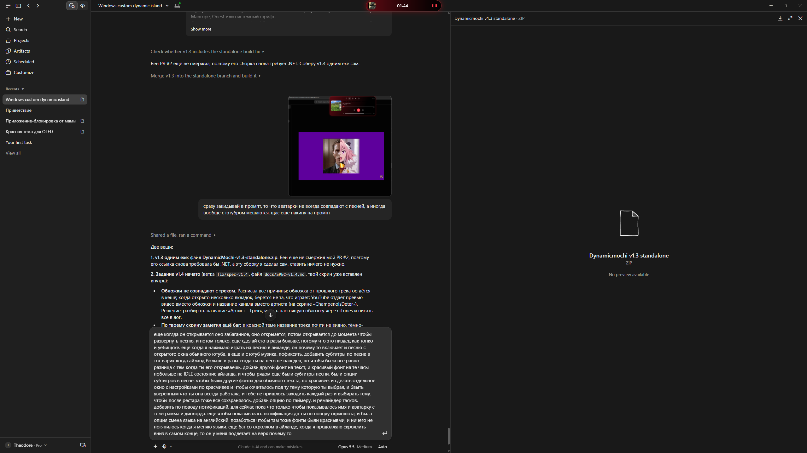
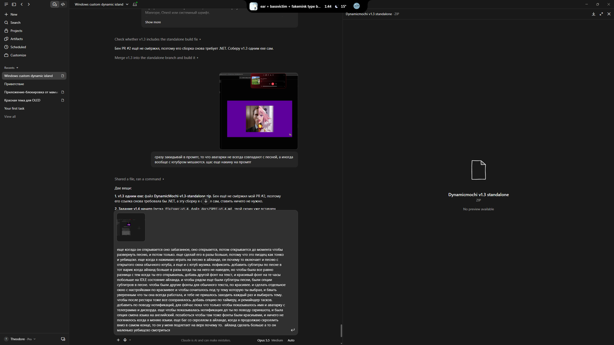
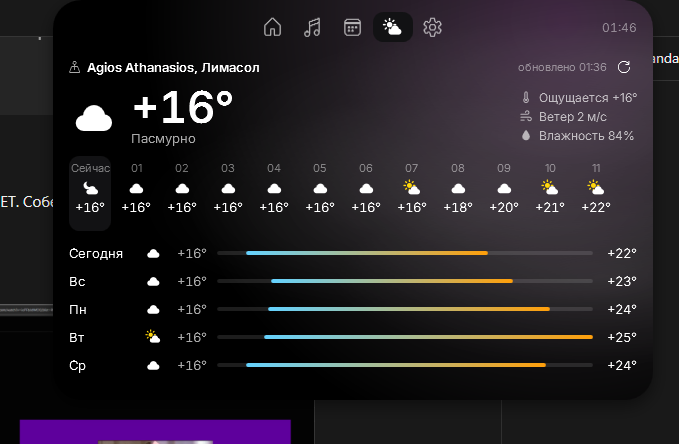

# Dynamic Mochi: задание v1.4

Этен → Бену. Баги по живому тесту v1.3. Всё, что не перечислено, не трогать. Коммиты как раньше (автор enlxxx, без Co-Authored-By).

**Сначала смёржи PR #2** (`fix/self-contained`): сборка становится одним exe без установки .NET. У тестера v1.3 без .NET не запустилась.

---

## 1. Обложка не совпадает с треком (критично)

На скрине: в Chrome играет YouTube-видео «Joost, Ski Aggu & Otto Waalkes — Friesenjung», а в острове обложка от **другого** ролика (кот на траве). Тестер говорит, что обложки часто не совпадают с песней, а с YouTube вообще путаются.

Причины, которые надо проверить и закрыть все:
- **Устаревший кеш обложки.** SMTC сначала присылает новое название, а миниатюру — позже (или присылает старую). Кеш по ключу «название|исполнитель» тогда запоминает чужую картинку. Нужно: подписаться на `MediaPropertiesChanged` текущей сессии и перечитывать миниатюру при **каждом** событии; после смены трека в течение 4 секунд перечитывать миниатюру раз в 500 мс и брать последнюю; сравнивать сами байты (хеш), а не только ключ.
- **Не та сессия.** Когда открыто несколько вкладок/плееров, `GetCurrentSession()` может вернуть не ту, что сейчас играет. Выбирать сессию, у которой статус `Playing`; если играют несколько — ту, что последней сменила трек. Обложку, название и кнопки брать **из одной и той же** сессии.
- **YouTube в браузере отдаёт превью видео, а не обложку альбома**, и в поле исполнителя — название канала (на скрине «ChampenoisDeter» вместо артиста). Нужно:
  - если источник — браузер (Chrome, Edge, Opera, Firefox, Яндекс) и название вида «Артист - Трек» / «Артист — Трек» / «Артист – Трек», разобрать его: артист и трек отдельно; убрать хвосты вроде «(Official Video)», «[Official Music Video]», «(Lyrics)», «(Audio)», «HD», «4K»;
  - найти нормальную обложку через **iTunes Search API** (`https://itunes.apple.com/search?term=<артист трек>&entity=song&limit=5`, бесплатно, без ключа; брать `artworkUrl100` и заменять `100x100` на `600x600`). Совпадение принимать только если название трека совпадает (как в правилах текстов песен), иначе оставить превью из SMTC;
  - найденную обложку кешировать на диске по «артист|трек»;
  - пока ищется — показывать то, что дал SMTC, потом плавно заменить (crossfade 220 мс).
- Если миниатюры нет вообще — заглушка из DESIGN.md, а **не** картинка от прошлого трека.
- Все шаги писать в `log.txt`: какая сессия выбрана, пришла ли миниатюра, искали ли в iTunes, что нашли.

Проверка: YouTube в Chrome (обычный и YouTube Music), Spotify, переключение треков подряд 10 раз быстро, две вкладки YouTube одновременно (одна на паузе). Обложка всегда от того трека, что сейчас играет.

## 2. Название трека не видно в красной теме

На том же скрине название трека во вкладке Музыка почти невидимое: тёмно-красный текст на тёмно-красном градиенте. Название должно быть `Fg` (белый) во всех тёмных темах. Проверить все 6 тем на всех вкладках: никакой текст не должен сливаться с фоном.

## 3. Раскрытие «в два этапа» выглядит как баг

При наведении капсула сначала подрастает до промежуточного размера, останавливается, и только потом раскрывается. Тестер воспринимает это как глюк. **Убрать промежуточный шаг из v1.3 (раздел 4):** наведение → через 150 мс одно непрерывное движение от свёрнутого вида к раскрытому (пружина 380 мс). Без остановок посередине.

## 4. Свёрнутая капсула больше и «живее»

Сейчас в покое капсула тонкая и мелкая. Ориентир — второй скрин: примерно такой же ширины, но **чуть выше**, чтобы больше уходила вниз. Без перебора: не должна закрывать вкладки и адресную строку браузера сильнее, чем сейчас на ~20 px.

- **Играет музыка: 420 × 58.** Слева обложка 40×40 (скругление 11). Справа от неё две строки:
  - верхняя: название трека 14 px SemiBold `Fg`, marquee;
  - нижняя: **текущая строка текста песни** 12.5 px `Sub`, смена строки — сдвиг вверх с fade 220 мс; если текста нет — исполнитель.
  - Справа: эквалайзер (4 полоски, до 18 px высотой), разделитель, часы 15 px.
- **Ничего не играет: 300 × 58.** Часы крупно **26 px** шрифтом часов (см. п. 6), рядом дата 13 px и погода (иконка 18 px + «+16°»).
- Раскрытый вид остаётся заметно больше (600 × по вкладке) — разница между свёрнутым и раскрытым должна чувствоваться.
- Режим «Минимальный» из v1.3 оставить как опцию в настройках, но **по умолчанию** теперь этот, крупный.
- Масштаб из «Общее → Размер острова» применяется и к этим размерам.

**Настройки текста песни** (окно настроек → Музыка):
- Где показывать: «В острове» (по умолчанию) / «Под островом» / «Нигде».
- Размер текста: слайдер.
- Показывать бэк-вокал: тумблер.
- Если текст не найден — показывать исполнителя (тумблер).

## 5. Кнопка Play запускает сразу несколько плееров (критично)

Нажатие «играть» в острове запустило одновременно YouTube в обычной вкладке **и** YouTube Music. Кнопки должны управлять **только той сессией**, которая показана в острове (та же, что выбрана в п. 1). Никаких команд в другие сессии. Если показанная сессия закрылась — кнопки неактивны, пока не появится новая. Проверить: две вкладки с видео на паузе + YouTube Music, нажать play в острове 10 раз — каждый раз играет только одна.

## 6. Шрифты: красивее, и отдельно для часов

Inter тестеру кажется скучным. Делаем два отдельных выбора в настройках → Внешний вид, с превью прямо в строке (название шрифта написано этим шрифтом, у часов — «12:34»):
- **Текст:** **Manrope** (по умолчанию), Onest, Inter, Golos Text, системный.
- **Часы:** **Unbounded** (по умолчанию, SemiBold), Manrope ExtraBold, Onest Bold, JetBrains Mono, Inter Display.
Все — OFL, с кириллицей, вшиты в приложение. Цифры часов всегда моноширинные (где шрифт не умеет tabular — выровнять каждую цифру в ячейку фиксированной ширины).

## 7. Окно настроек: красивее, в цвет темы, и всё сохраняется

- Окно настроек красится **в выбранную тему острова**: фон окна — тот же градиент темы (в цветных темах цвет уходит в чёрный), акценты, тумблеры, выделенный пункт меню — `Accent` темы. В Белой — светлое окно. Mica оставить только для OLED/Белой, если с градиентом смотрится грязно.
- Больше воздуха: отступы 24, карточки-группы скругление 14, у разделов меню — цветные иконки в кружках (как у системных настроек Windows 11, но в цветах темы).
- **Сохранение (критично):** тестеру приходится заново выбирать тему после перезапуска. Все настройки должны переживать перезапуск и перезагрузку ПК. Писать `settings.json` атомарно (во временный файл → `File.Replace`), сохранять сразу после каждого изменения, при запуске читать до показа острова. Если файл битый — лог + бэкап `settings.bak.json`, а не сброс в молчании. Проверка: выбрать тему, шрифты, место, закрыть через «Выйти», запустить — всё как было; то же после перезагрузки Windows (автозапуск).

## 8. Баг прокрутки

Если продолжать крутить колёсико вниз, когда уже дошёл до конца (в Настройках острова, в Погоде, в Календаре), содержимое **прыгает наверх**. Конец списка — это конец: дальше крутить ничего не должно происходить. Проверить все прокручиваемые места. Колёсико над свёрнутой капсулой (громкость) не должно срабатывать, когда остров раскрыт.

## 9. Таймер и задачи

Новая вкладка не нужна — кладём в «Календарь» вторым режимом, переключатель сверху: **Календарь / Задачи / Таймер**.
- **Таймер:** быстрые кнопки 1 / 5 / 10 / 25 мин + ввод своего времени. Пока идёт — в свёрнутой капсуле справа кольцо прогресса и «04:59» вместо часов; при музыке — вместе с ней. По окончании — капсула мигает цветом `Accent`, короткий звук (системный), уведомление в острове «Таймер 5 мин — готово». Пауза/стоп по клику.
- **Задачи:** список дел с чекбоксами, у задачи можно задать время напоминания. Напоминание — как у событий календаря (live-событие в капсуле). Выполненные — зачёркнуты, через сутки уходят в «Выполненные». Хранить в `tasks.json`.

## 10. Уведомления: Telegram, Discord, скриншоты

**Telegram и Discord** — пока только простое уведомление в острове: аватарка (круг 32 px), имя отправителя/канала 13 px SemiBold, первые слова сообщения 12 px `Sub`, иконка приложения маленькая в углу аватарки. Капсула расширяется до ~440 × 58 на 5 секунд, потом обратно. Клик — открыть приложение.
- Технически: `UserNotificationListener` (Windows.UI.Notifications.Management). Требует, чтобы у приложения была **package identity** — сделать sparse package (MSIX без переупаковки exe) или полноценный MSIX. Если без identity никак — сделать, но честно написать в журнале, что для этого нужно, и не ломать запуск без уведомлений.
- В настройках: тумблер «Уведомления в острове» + список приложений с тумблерами (Telegram, Discord). Разрешение Windows запрашивать по кнопке, с понятным текстом, если пользователь отказал.

**Скриншоты:** после Win+Shift+S / PrtScn — в капсуле превью скриншота (миниатюра 48 px высотой) + «Скриншот скопирован». Клик — открыть в редакторе (Snipping Tool). Отслеживать изменение буфера обмена (картинка) и папку `Pictures\Screenshots`.

## 11. Английский язык

- Все строки интерфейса — в ресурсы (`Strings.ru.resx`, `Strings.en.resx`), включая окно настроек, дни недели, месяцы, погоду, уведомления.
- Переключение в настройках применяется **сразу**, без перезапуска.
- Ничего не должно ломаться: английские строки бывают длиннее/короче — никаких обрезаний и наездов, проверить каждую вкладку и окно настроек на обоих языках. Шрифты те же (у всех выбранных есть и латиница, и кириллица).
- Даты и время — по выбранному языку (`ru-RU` / `en-US`), 24-часовой формат по умолчанию, опция 12-часового.

## 12. Погода: облачно не должно быть «мёртвым»

Сейчас при облачности на фоне почти ничего не происходит. Сделать «облачную» анимацию живой:
- **Слои облаков с параллаксом:** 3 слоя мягких размытых облаков, дальние — бледнее и медленнее, ближние — крупнее и быстрее. Скорость и направление зависят от **реального ветра** (`wind_speed_10m`, `wind_direction_10m`).
- **Тени облаков:** раз в 15–25 с по содержимому медленно проходит едва заметное затемнение (как тень облака по земле), 4–6 с.
- **Переменная облачность:** солнце иногда выглядывает между облаками — ореол мягко разгорается на 3–5 с и снова прячется.
- **Ночью:** облака подсвечены снизу холодным лунным светом, сквозь просветы иногда видны звёзды.
- **Сильный ветер** (≥ 8 м/с): поверх — тонкие быстрые линии ветра, по 1–2 штуки.
- В окне настроек → Погода: «Живой фон: выкл / спокойный / полный» (спокойный — без теней и линий ветра).

## Чек-лист v1.4
- [ ] Обложка всегда от текущего трека (YouTube, YouTube Music, Spotify, две вкладки)
- [ ] Play/пауза управляет только показанной сессией
- [ ] Раскрытие одним движением, без остановки посередине
- [ ] Свёрнутая 420×58 с названием и строкой текста песни; без музыки 300×58 с крупными часами
- [ ] Шрифты текста и часов выбираются отдельно, по умолчанию Manrope + Unbounded
- [ ] Окно настроек в цветах темы; все настройки сохраняются после перезапуска и перезагрузки
- [ ] Прокрутка в конце списка никуда не прыгает
- [ ] Таймер и задачи с напоминаниями работают
- [ ] Уведомления Telegram/Discord (или честная запись, что нужно для identity); уведомление о скриншоте
- [ ] Английский язык без поломок вёрстки, переключение без перезапуска
- [ ] Облачная погода живая, настройка интенсивности фона
- [ ] Сборка одним exe (PR #2), ссылка на релиз, запись в журнал
