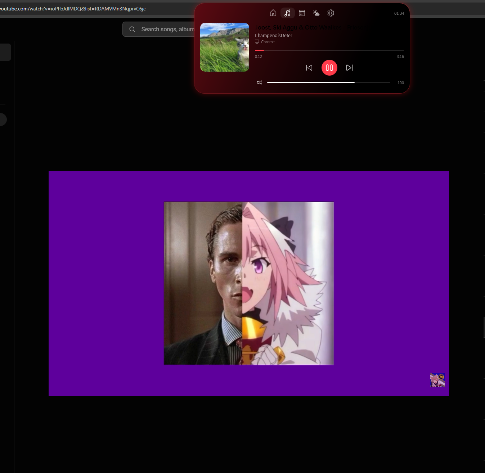

# Dynamic Mochi: задание v1.4

Этен → Бену. Баги по живому тесту v1.3. Всё, что не перечислено, не трогать. Коммиты как раньше (автор enlxxx, без Co-Authored-By).

**Сначала смёржи PR #2** (`fix/self-contained`): сборка становится одним exe без установки .NET. У тестера v1.3 без .NET не запустилась.

---

## 1. Обложка не совпадает с треком (критично)

На скрине: в Chrome играет YouTube-видео «Joost, Ski Aggu & Otto Waalkes — Friesenjung», а в острове обложка от **другого** ролика (кот на траве). Тестер говорит, что обложки часто не совпадают с песней, а с YouTube вообще путаются.

Причины, которые надо проверить и закрыть все:
- **Устаревший кеш обложки.** SMTC сначала присылает новое название, а миниатюру — позже (или присылает старую). Кеш по ключу «название|исполнитель» тогда запоминает чужую картинку. Нужно: подписаться на `MediaPropertiesChanged` текущей сессии и перечитывать миниатюру при **каждом** событии; после смены трека в течение 4 секунд перечитывать миниатюру раз в 500 мс и брать последнюю; сравнивать сами байты (хеш), а не только ключ.
- **Не та сессия.** Когда открыто несколько вкладок/плееров, `GetCurrentSession()` может вернуть не ту, что сейчас играет. Выбирать сессию, у которой статус `Playing`; если играют несколько — ту, что последней сменила трек. Обложку, название и кнопки брать **из одной и той же** сессии.
- **YouTube в браузере отдаёт превью видео, а не обложку альбома**, и в поле исполнителя — название канала (на скрине «ChampenoisDeter» вместо артиста). Нужно:
  - если источник — браузер (Chrome, Edge, Opera, Firefox, Яндекс) и название вида «Артист - Трек» / «Артист — Трек» / «Артист – Трек», разобрать его: артист и трек отдельно; убрать хвосты вроде «(Official Video)», «[Official Music Video]», «(Lyrics)», «(Audio)», «HD», «4K»;
  - найти нормальную обложку через **iTunes Search API** (`https://itunes.apple.com/search?term=<артист трек>&entity=song&limit=5`, бесплатно, без ключа; брать `artworkUrl100` и заменять `100x100` на `600x600`). Совпадение принимать только если название трека совпадает (как в правилах текстов песен), иначе оставить превью из SMTC;
  - найденную обложку кешировать на диске по «артист|трек»;
  - пока ищется — показывать то, что дал SMTC, потом плавно заменить (crossfade 220 мс).
- Если миниатюры нет вообще — заглушка из DESIGN.md, а **не** картинка от прошлого трека.
- Все шаги писать в `log.txt`: какая сессия выбрана, пришла ли миниатюра, искали ли в iTunes, что нашли.

Проверка: YouTube в Chrome (обычный и YouTube Music), Spotify, переключение треков подряд 10 раз быстро, две вкладки YouTube одновременно (одна на паузе). Обложка всегда от того трека, что сейчас играет.

## 2. Название трека не видно в красной теме

На том же скрине название трека во вкладке Музыка почти невидимое: тёмно-красный текст на тёмно-красном градиенте. Название должно быть `Fg` (белый) во всех тёмных темах. Проверить все 6 тем на всех вкладках: никакой текст не должен сливаться с фоном.
