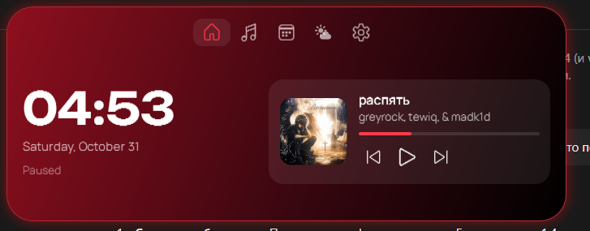

# Dynamic Mochi: задание v1.6

Этен → Бену. Делать после v1.4 (и v1.5, если уже сделана). Не трогать то, что не перечислено. Каждая новая настройка — в окне «Все настройки», раздел указан. Коммиты как раньше.

## 1. Настройка силы свечения (GLOW)
- Раздел **Внешний вид** → «Свечение»: слайдер 0–100%, по умолчанию 50%. 0 = без свечения.
- Применяется к капсуле и окну настроек сразу, без перезапуска.

## 2. Переработка OLED и две отдельные темы
- Тема **OLED Black** — полностью чёрная (`#000000`), без градиента, без свечения. Для тех, кто хочет тотальный чёрный.
- Тема **Gradient Black** — тёмно-чёрная база с **мягким** градиентом, сверху и снизу: верх и низ чуть подсвечены цветом, середина чёрная. Градиент сдержанный: цвет слабее, чем в цветных темах (не больше 25% насыщенности).
- В окне настроек, внутри **Внешний вид**, добавить переключатель для Gradient Black: «Цвет песни» (градиент берётся из доминирующего цвета обложки, как в v1.2) или «Фиксированный» (фиолетовый). Внутри темы это опция, а не отдельная тема.
- Фиолетовая тема: **Фиолетовая** — по аналогии с остальными цветными (GradTop `#4A0E7A`, GradMid `#1E0838`, Accent `#B45CFF`), то же, что и у красной/синей/зелёной/оранжевой. Всего тем 8, сетка 4×2: Белая, OLED, Градиент, Фиолетовая / Красная, Синяя, Зелёная, Оранжевая.
- Проверка: все 8 тем рядом, отличаются с первого взгляда.

## 3. Песенные лирики в окне настроек, а не на острове
- Тумблер «Текст песни» (и связанные опции: где показывать, размер, бэк-вокал) убрать из вкладки Настройки острова.
- Перенести в «Все настройки» → **Музыка**. На самом острове остаётся только быстрая кнопка «Все настройки».

## 4. Новая вкладка «Питание» (сон, блокировка, выключение)
- Новая иконка на панели вкладок острова. Внутри — сетка плиток 2×3 с иконками Segoe Fluent:
  - **Сон** (`E708`) — `SetSuspendState(false)` через P/Invoke (rundll32 на ПК с включённой гибернацией вместо сна уходит в гибернацию).
  - **Заблокировать** (`E72E`) — `rundll32.exe user32.dll,LockWorkStation`.
  - **Выключить** (`E7E8`) — `shutdown /s /t 0`.
  - **Перезагрузить** (`E72C`) — `shutdown /r /t 0`.
  - **Выйти из учётки** (`E748`) — `shutdown /l`.
  - **Гибернация** (`E81C`) — `SetSuspendState(true)`.
- Перед выключением, перезагрузкой и выходом — подтверждение: первый клик красит плитку в красный и пишет «Точно? Нажми ещё раз», второй клик в течение 5 секунд выполняет, иначе отмена. Сон и блокировка без подтверждения.
- Настройки → Общее: тумблер «Показывать вкладку Питание» (вкл по умолчанию).
- Проверка: каждая кнопка реально выполняет команду; без прав администратора всё работает.

## 5. Пустое главное меню — идеи
Сейчас раскрытый остров по умолчанию бедный. Предложить и реализовать (по одному блоку, с тумблером в настройках, по умолчанию выключено, кроме первых двух):
- **Быстрые действия** (вкл): пауза/плей, предыдущий/следующий, «Не беспокоить», скриншот — ряд крупных кнопок.
- **Ближайшее событие** (вкл): следующая встреча/задача с временем и цветом (уже есть из v1.4, вынести в карточку).
- **Погода сейчас** (вкл): короткая карточка, по клику — вкладка Погода.
- **Прогноз дня** (выкл): почасовой мини-график температуры.
- **Заметка** (выкл): одна строка текста, сохраняется в `note.txt`, для быстрых мыслей.
- **Статистика** (выкл): сколько времени играла музыка сегодня и сколько раз открыл остров.

Проверка: главное меню не пустое при включённых блоках и не переполнено при всех; высота подстраивается плавно.

## Чек-лист v1.6
- [ ] Свечение регулируется слайдером, 0 = без свечения
- [ ] OLED Black чёрная, Gradient Black с сдержанным градиентом и переключателем «Цвет песни / Фиксированный»
- [ ] Фиолетовая тема добавлена, все 8 тем различимы
- [ ] Лирики только в настройках, на острове одна кнопка
- [ ] Вкладка Питание: все 6 действий работают, опасные с подтверждением
- [ ] Главное меню с блоками, всё включается/выключается
- [ ] Сборка одним exe, релиз с номером версии, запись в журнал

## 6. Главное меню: погода и блоки (уточнение пункта 5)

**Главное правило: часы и плеер не уменьшаются.** Они остаются такого же размера, как сейчас (часы — 52 px, карточка музыки — 72 px обложка, кнопки 32 px). Новые блоки занимают только свободное место внизу и справа. Если места не хватает, блок скрывается, а не сжимает часы или плеер.

Порядок блоков сверху вниз, под часами и карточкой музыки, в одну строку или сетку 2×1:
1. **Ближайшее событие или задача** (вкл): строка 13 px, цветная точка слева, «14:30 · Созвон». Нет события — блок скрыт.
2. **Погода сейчас** (вкл): иконка 22 px, «+16°» 15 px SemiBold, город 12 px `Sub`, справа ветер мелко. Клик → вкладка Погода. Высота блока не больше 44 px.
3. **Быстрые кнопки** (вкл): ряд из 4 кнопок 36×36: скриншот, «не беспокоить», блокировка, пауза. Иконки 16 px.
4. **Заметка** (выкл): одна строка, сохраняется в `note.txt`.
5. **Таймер / помодоро** (только когда запущен): кольцо 28 px и время.

Правила:
- Никакой блок не делает шрифт или иконку часов и плеера меньше, даже когда блоков много.
- Все блоки вместе не выше 96 px. Если не влезают — самый нижний скрывается.
- Переход появления и скрытия блока — fade 180 мс, без скачков высоты всего меню.
- В настройках → Общее → «Главное меню»: тумблер на каждый блок, порядок не меняется.

Проверка: при всех включённых блоках часы и плеер остаются того же размера, что без блоков; при маленьком окне нижние блоки скрыты, а не сжаты.
